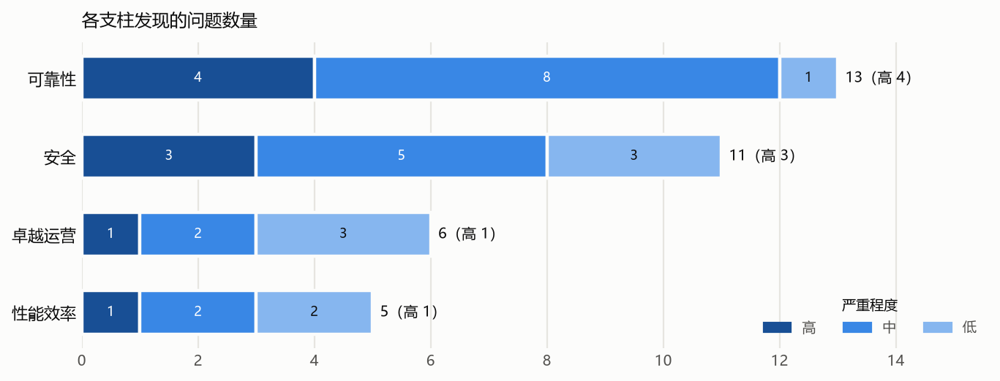

# 示例客户 Azure 巡检汇总报告（2026 年 10 月）

**范围**：示例客户 5 个 Azure 订阅。另有 1 个未启用订阅（old-lab）无法读取，未纳入检查。

**方式**：使用贵司提供的账号，以只读方式读取费用、配置、监控指标和日志，没有修改任何资源，也没有做端口扫描。

**时间**：

- 费用：对比 2026 年 9 月与 8 月两个完整自然月。
- 配置：2026 年 10 月 26 日读取。
- 性能：2026 年 9 月 26 日至 10 月 26 日的数据。

本报告按 Microsoft Azure Well-Architected Framework（WAF）的五个支柱汇总结论：成本优化、可靠性、安全、卓越运营、性能效率。每项问题的资源明细见附件。

## 1. 总体结论

|项目|结果|
|---|---|
|9 月费用|USD 17,350.94，比 8 月增加 7.13%；日均费用上升 10.70%|
|10 月预计费用|约 USD 18,475.53（Azure 预测）|
|VM 规格调整|7 台建议降配，**每月约节省 USD 760.51**（官网列表价）|
|VM 降配后再购买 1 年 RI|VM 计算费用每月从 USD 2,750.28 降到 USD 1,193.86，**每月约节省 USD 1,556.42**（官网列表价）|
|可靠性与安全|发现 24 项问题，其中高风险 7 项|
|卓越运营与性能效率|发现 11 项问题，其中高风险 2 项|
|与 2026-08 相比|新增问题 5 项，新增检查项发现 1 项，仍未处理 29 项，已解决 2 项|
|同类资源配置对比|8 处配置偏差，其中高风险 4 处|

**最需要先处理的是支付数据库 pay-mysql-prod**：防火墙放行所有地址、没有强制加密，也没有高可用和异地备份。问题主要集中在门户手工创建的资源上，按 Terraform 模块创建的同类资源大多已经符合推荐做法。

**9 月费用 USD 17,350.94，比 8 月增加 7.13%**，增长最快的是 data-prod 的 Azure OpenAI（约 44%），来自工作日调用量增加。7 台虚拟机调整规格预计每月节省 USD 760.51（Azure 官网公开列表价），降配稳定后再买 1 年预留实例，合计每月约节省 USD 1,556.42。

费用和预计费用来自 Azure 账单和 Azure 预测；规格调整和 RI/SP 的节省按 Azure 官网公开列表价计算，不是贵司的合同价。

## 2. 需要立即处理的问题

|#|问题|影响|建议|
|---|---|---|---|
|1|**支付数据库对全网开放**。pay-mysql-prod 的防火墙规则 AllowAll 放行所有地址，且没有强制加密连接。|任何人都能连接支付数据库端口，只靠密码防护。|**根本原因**：该库在门户手工创建，并在门户上点了“允许全部”；其他生产库都由 Terraform 模块创建、只走私有终结点。**根治**：按模块改为私有终结点访问，删除公网规则。**短期**：立即删除 AllowAll 规则，只保留办公网出口 IP。|
|2|**存储容器可匿名访问**。shopassets 的 exports 容器允许匿名列出和下载。|如存放内部文件，可能已对外泄露。|确认容器内容；不需要公开的关闭匿名访问|
|3|**支付数据库没有高可用和异地备份**。pay-mysql-prod 单可用区部署，备份只在本区域。|可用区故障时支付服务中断。|开启跨可用区高可用和异地冗余备份|
|4|**AKS 管理接口对公网开放**。shop-aks 的 API Server 不限制来源 IP，本地账号未禁用。|拿到凭据的人可从任何地方管理集群。|设置授权 IP 范围；集成 Entra ID 并禁用本地账号|
|5|**PostgreSQL 关闭了存储自动增长**。data-pg-prod 存储已用约 71%。|写满后数据库变为只读。|开启存储自动增长并配置存储告警|
|6|**shop-batch-01 CPU 长期打满**。30 天平均 86%，21 天日最高超过 95%。|批处理任务排队变慢。|确认是否为预期负载；是的话升到 16 vCPU 或拆分任务|
|7|**生产集群没有监控**。shop-aks 没有 Container Insights 和任何告警。|节点或 Pod 故障时没人第一时间知道。|启用 Container Insights 并配置基础告警|
|8|**Redis 内存快速增长**。shop-redis-prod 内存从 12% 涨到 41%。|约 6 周后达到 80%，可能驱逐数据。|确认增长原因，必要时提前扩容|

## 3. 成本优化

### 9 月费用

- **AI 调用量增长最快**。data-prod 的 Azure OpenAI 9 月费用比 8 月高约 44%，主要是工作日调用量增加，单价没有变化。
- **支付业务新增一台 PostgreSQL**。pay-prod 9 月 8 日起新增 pay-pg-prod，9 月约 USD 570。
- **测试环境费用下降**。shop-test 的 shop-web-test-02 8 月 20 日起已释放，9 月不再计费。

### 可量化的节省机会（官网列表价）

|方案|当前每月 USD|调整后每月 USD|每月节省 USD|
|---|---:|---:|---:|
|VM 降配（7 台）后，按需，不用 RI/SP|2,750.28|1,989.76|760.51|
|VM 降配（7 台）后，1 年 RI|2,750.28|1,193.86|1,556.42|
|VM 降配（7 台）后，1 年 SP|2,750.28|1,353.06|1,397.22|

- 各 VM 方案需要选择一种，节省不能相加。
- VM 的 3 年 RI 和 SP 价格见附件二。
- 建议先降配并观察稳定后，再按实际长期用量确定 RI 或 SP 的数量和期限。

### 需要贵司确认后才能估算节省的项目

|项目|现状|
|---|---|
|datalakeraw 存储|约 26 TiB 全部在 Hot 层，没有生命周期策略|
|低使用率数据库|pay-mysql-prod 的 CPU 和内存 9 月平均均低于 20%|

## 4. 可靠性

共 13 项问题：高 4 项、中 8 项、低 1 项。

- 支付库 pay-mysql-prod 没有高可用和异地备份
- 2 台保存数据的虚拟机没有备份

## 5. 安全

共 11 项问题：高 3 项、中 5 项、低 3 项。

- pay-mysql-prod 对全网开放
- shopassets 的 exports 容器可匿名访问
- shop-aks API Server 不限制来源 IP

## 6. 卓越运营

共 6 项问题：高 1 项、中 2 项、低 3 项。

## 7. 性能效率

共 5 项问题：高 1 项、中 2 项、低 2 项。

## 8. 建议处理计划

**本周内**

- 删除 pay-mysql-prod 的全网放行规则
- 确认 shopassets/exports 内容并关闭匿名访问
- 确认 shop-redis-prod 内存增长原因
- 确认 shop-batch-01 的负载是否正常

**一个月内**

- 为 pay-mysql-prod 开启高可用和异地备份
- 限制 shop-aks API Server 来源 IP
- 为保存数据的虚拟机配置备份
- 为 shop-aks 和生产数据库补齐监控告警
- 为关键数据资源加删除锁

**一个季度内**

- 把手工创建的数据库按 Terraform 模块对齐
- AKS 升级到 Standard 层并规划版本升级
- 统一在 IaC 模块中加负责人和成本中心标签
- 按需要延长日志保留期

## 9. 需要贵司确认或提供的信息

- 生产和测试环境的划分：本次按订阅和资源名称判断。
- shopassets/exports 容器是否用于对外分发。
- 支付库的恢复时间目标和数据丢失容忍度。
- 各资源的负责人和月度预算目标。

## 10. 后续

建议每月做一次巡检，覆盖费用变化、资源利用率、闲置资源和 RI/SP 使用情况，并跟踪本报告中各项问题的处理结果。下一次可在 10 月账单完整后开始。

## 附件

|编号|文件|内容|
|---|---|---|
|一|01_9 月月度成本巡检报告（Markdown、Excel）|9 月费用对比、变化原因、数据库与存储日志用量、闲置资源、建议跟踪表|
|二|02_虚拟机利用率与规格优化（Markdown、Excel）|逐台 VM 的利用率、建议规格及按需、1 年和 3 年 RI、SP 价格|
|三|03_可靠性与安全巡检报告、03_可靠性与安全巡检问题清单|24 项问题的明细、建议、验收标准和跟踪列|
|四|04_卓越运营与性能效率巡检报告、04_卓越运营与性能效率巡检问题清单|11 项问题的明细、建议、验收标准和跟踪列|
|五|05_同类资源配置对比报告、05_同类资源配置对比明细|各类资源的标准做法、不符合的资源及原因、需要修正的模板默认值|
