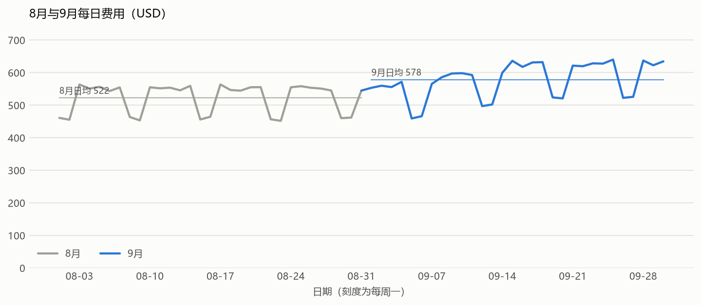
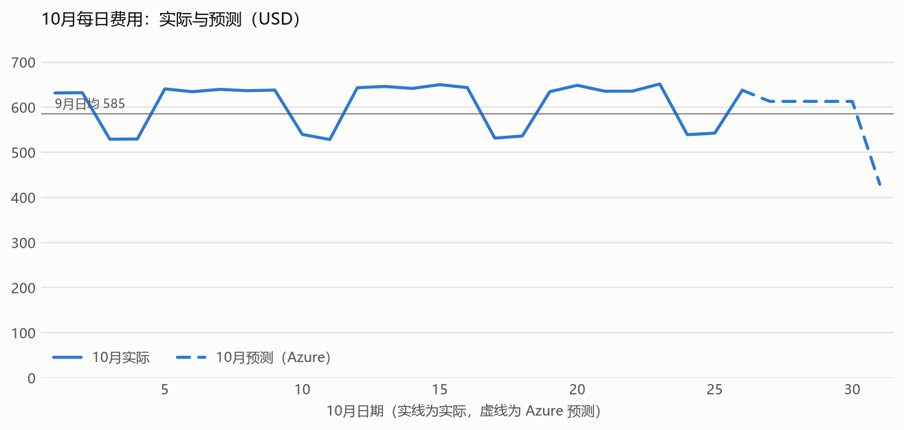
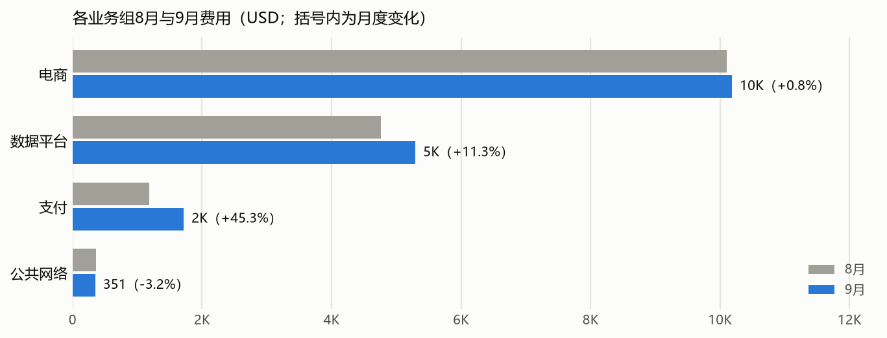
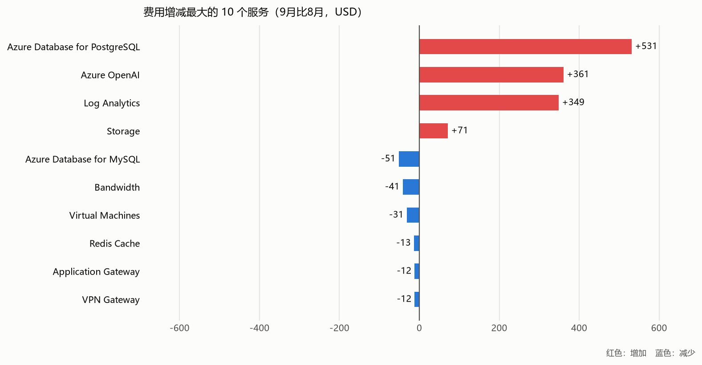
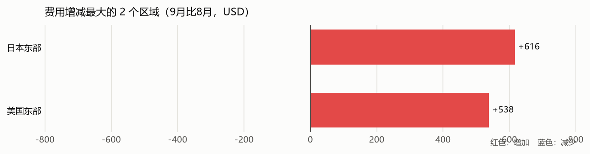

# 示例客户 2026 年 9 月月度成本巡检报告

**统计期间：2026 年 9 月 1 日至 30 日；对比 2026 年 8 月 1 日至 31 日。范围：示例客户 5 个 Azure 订阅（另有 1 个订阅的费用无法读取，见第 8 节）。金额单位：USD**。

历史费用来自 Azure Cost Management 的实际费用查询，不是官网列表价；优化建议中的公开报价另行标注为列表价。

8 月和 9 月费用查询完成时间：2026 年 10 月 29 日 21:12（UTC）；区域、预测、变化原因、数据库、存储和日志检查于 10 月 26 日读取。

## 1. 费用总览

- 9 月费用（5 个订阅） **USD 17,350.94**，8 月 **USD 16,196.36**，增减 **USD 1,154.58（+7.13%）**。
- 9 月日均 **USD 578.36**，8 月日均 **USD 522.46**，日均变化 **+10.70%**。9 月比 8 月少 1 天，月总额与日均值一起看。
- 实际费用查询：5 个订阅的 9 月费用、5 个订阅的 8 月费用均已读取，以上增减比较使用这 5 个订阅；另有 1 个订阅的费用无法读取：订阅未启用（old-lab），没有按 0 处理。
- **10 月预计约 USD 18,475.53**（Azure 预测）：截至查询日实际 USD 15,625.71，其余日期预测 USD 2,849.82。全月日均约 USD 595.98，比 9 月日均高 3.05%；预测需在 10 月结束后核对。
- 费用按查询时结果列示；税费、信用额度和最终发票调整需与财务账单核对。

费用有明显的每周规律：工作日高、周末低；9 月中旬起 AI 调用量上升。

实线为 10 月已发生的实际费用，虚线为 Azure 预测；预测基于历史费用模型，节假日和新上线业务可能使实际偏离预测。

### 需要优先关注的变化

- **AI 调用量增长最快**。data-prod 的 Azure OpenAI 9 月费用比 8 月高约 44%，主要是工作日调用量增加，单价没有变化。
- **支付业务新增一台 PostgreSQL**。pay-prod 9 月 8 日起新增 pay-pg-prod，9 月约 USD 570。
- **测试环境费用下降**。shop-test 的 shop-web-test-02 8 月 20 日起已释放，9 月不再计费。

## 2. 哪些业务、服务和区域变化最大

|业务组|8 月费用 USD|9 月费用 USD|增减 USD|变化率|日均变化率|
|---|---:|---:|---:|---:|---:|
|电商|9,893.94|9,986.27|92.32|+0.93%|+4.30%|
|数据平台|4,757.70|5,295.89|538.19|+11.31%|+15.02%|
|支付|1,182.02|1,717.78|535.77|+45.33%|+50.17%|
|公共网络|362.70|351.00|-11.70|-3.23%|+0.00%|

### 主要服务

|服务|8 月费用 USD|9 月费用 USD|增减 USD|日均变化率|
|---|---:|---:|---:|---:|
|Log Analytics|5,023.20|5,371.83|348.63|+10.51%|
|Bandwidth|2,864.02|2,822.70|-41.32|+1.84%|
|Virtual Machines|2,638.22|2,613.02|-25.20|+2.35%|
|Azure Database for PostgreSQL|1,286.50|1,817.70|531.20|+46.00%|
|Azure Database for MySQL|1,590.30|1,539.00|-51.30|-0.00%|
|Azure OpenAI|826.92|1,187.53|360.61|+48.40%|
|Storage|727.19|799.15|71.96|+13.56%|
|Redis Cache|409.20|396.00|-13.20|+0.00%|
|Application Gateway|365.80|354.00|-11.80|+0.00%|
|VPN Gateway|362.70|351.00|-11.70|+0.00%|
|Azure Kubernetes Service|74.40|72.00|-2.40|+0.00%|
|Key Vault|27.90|27.00|-0.90|+0.00%|

### 按资源所在区域

这里按资源实际部署区域统计，与上面的订阅业务分组不同。

|区域|8 月费用 USD|9 月费用 USD|增减 USD|9 月占比|日均变化率|
|---|---:|---:|---:|---:|---:|
|日本东部（ja east）|11,438.66|12,055.05|616.39|69.5%|+8.90%|
|美国东部（us east）|4,757.70|5,295.89|538.19|30.5%|+15.02%|

其余区域见 Excel“区域对比”。

## 3. 费用变化原因

下表按资源和计量比较了 8 月与 9 月的费用和用量，前 10 项增长和前 5 项下降均已拆分到具体资源。计量名称是 Azure 账单中的计费项目名称。

|订阅|服务|8 月 USD|9 月 USD|增减 USD|主要原因|
|---|---|---:|---:|---:|---|
|pay-prod|Azure Database for PostgreSQL|0.00|572.70|572.70|9 月 8 日新增 pay-pg-prod（4 vCore），属于新上线的对账服务|
|shop-prod|Log Analytics|3,181.36|3,556.31|374.95|9 月 15 日起 checkout-api 容器开启调试日志，日志量增加约 25%|
|data-prod|Azure OpenAI|826.92|1,187.53|360.61|工作日调用量增加约 44%（输入 token 数量增加），单价不变|
|data-prod|Virtual Machines|374.98|537.98|163.01|9 月 12 日新增 data-worker-01（D8s_v5），用于新的报表任务|
|data-prod|Storage|427.46|509.84|82.39|日均用量变化 USD +84；天数差异 USD -14；新增计量或资源 USD +12；新增 1 个资源（按账单拆分，业务原因待确认）|
|shop-prod|Storage|212.73|216.63|3.90|日均用量变化 USD +11；天数差异 USD -7（按账单拆分，业务原因待确认）|
|shop-test|Virtual Machines|303.55|178.56|-124.99|shop-web-test-02 于 8 月 20 日释放，9 月不再计费|
|shop-prod|Virtual Machines|1,590.67|1,539.36|-51.31|天数差异 USD -51（按账单拆分，业务原因待确认）|
|data-prod|Azure Database for PostgreSQL|1,286.50|1,245.00|-41.50|天数差异 USD -42（按账单拆分，业务原因待确认）|
|shop-prod|Bandwidth|2,864.02|2,822.70|-41.32|天数差异 USD -92；日均用量变化 USD +51（按账单拆分，业务原因待确认）|
|data-prod|Log Analytics|1,841.84|1,815.53|-26.31|天数差异 USD -59；日均用量变化 USD +33（按账单拆分，业务原因待确认）|

“单位费用变化”按实际费用除以计费数量计算，可能来自价格调整或折扣，账单数据无法区分。新增、停用、用量、天数和单位费用的拆分金额见 Excel“变化原因拆解”，主要计量见“主要计量变化”。业务上为什么增加（如新项目上线、新模型试用）仍需业务团队确认。

## 4. 主要资源费用

|订阅|资源组|资源|服务|9 月费用 USD|
|---|---|---|---|---:|
|shop-prod|shop-rg|shop-logs|Log Analytics|3,556.31|
|shop-prod|shop-rg|shop-appgw|Bandwidth|2,822.70|
|data-prod|data-rg|data-logs|Log Analytics|1,815.53|
|data-prod|data-rg|data-pg-prod|Azure Database for PostgreSQL|1,245.00|
|data-prod|data-rg|data-openai|Azure OpenAI|1,187.53|
|pay-prod|pay-rg|pay-mysql-prod|Azure Database for MySQL|708.00|
|shop-prod|shop-rg|shop-mysql-prod|Azure Database for MySQL|708.00|
|pay-prod|pay-rg|pay-pg-prod|Azure Database for PostgreSQL|572.70|
|data-prod|data-rg|datalakeraw|Storage|477.65|
|shop-prod|shop-rg|shop-search-01|Virtual Machines|468.00|
|shop-prod|shop-rg|shop-redis-prod|Redis Cache|396.00|
|data-prod|data-rg|data-etl-01|Virtual Machines|362.88|
|shop-prod|shop-rg|shop-batch-01|Virtual Machines|357.12|
|shop-prod|shop-rg|shop-appgw|Application Gateway|354.00|
|shared-network|network-rg|shared-vpn|VPN Gateway|351.00|
|pay-prod|pay-rg|pay-api-01|Virtual Machines|178.56|
|pay-prod|pay-rg|pay-api-02|Virtual Machines|178.56|
|shop-prod|shop-rg|shop-web-01|Virtual Machines|178.56|
|shop-prod|shop-rg|shop-web-02|Virtual Machines|178.56|
|shop-prod|shop-rg|shop-web-03|Virtual Machines|178.56|

完整订阅、服务、资源组、资源和每日费用见 Excel。未归属资源的费用保持未归属，不根据名称猜测。

## 5. 资源利用率与后续优化建议

### 虚拟机

9 月历史费用与当前资源建议分开。当前仍存在的机器可读取 9 月历史指标，但不能还原 9 月已删除的全部资源，也不能把当前规格和电源状态当作 9 月状态。

### 数据库和缓存

按 9 月每日平均值计算；规格为 10 月 26 日的当前配置。“CPU 和内存均低于 20%”只作为容量评审线索，调整前需确认峰值、高可用和副本需求。

|类型|数量|9 月费用 USD|完整 30 日|CPU 和内存均低于 20%|这些资源 9 月费用 USD|
|---|---:|---:|---:|---:|---:|
|MySQL 灵活服务器|3|1,539.00|3|2|831.00|
|PostgreSQL 灵活服务器|2|1,817.70|1|0|0.00|
|Azure Cache for Redis（旧版）|1|396.00|1|1|396.00|

费用较高的低使用率资源：

|订阅|名称|规格|9 月费用 USD|CPU 平均|内存平均|实际内存使用|有效日|
|---|---|---|---:|---:|---:|---:|---:|
|pay-prod|pay-mysql-prod|Standard_D4ds_v4|708.00|9.4%|16.8%|-|30|

shop-redis-prod9 月利用率低，但 10 月内存使用快速增长（见卓越运营与性能效率巡检报告），不列为降档候选。

Redis 的内存百分比按整数上报，低于 1%会显示为 0%，因此同时列出实际内存使用量。完整清单见 Excel“数据库与缓存用量”。

### 建议清单

|检查方向|发现或需要确认的内容|建议怎么做|状态|
|---|---|---|---|
|费用增长 / pay-prod / Azure Database for PostgreSQL|9 月费用 USD 572.70，较 8 月增加 USD 572.70；日均变化不适用。9 月 8 日新增 pay-pg-prod（4 vCore），属于新上线的对账服务|确认新增数据库是否为计划上线，纳入数据库用量检查|待业务确认|
|费用增长 / shop-prod / Log Analytics|9 月费用 USD 3,556.31，较 8 月增加 USD 374.95；日均变化+15.51%。9 月 15 日起 checkout-api 容器开启调试日志，日志量增加约 25%|确认日志采集范围和保留需求，见日志检查项|待业务确认|
|费用增长 / data-prod / Azure OpenAI|9 月费用 USD 1,187.53，较 8 月增加 USD 360.61；日均变化+48.40%。工作日调用量增加约 44%（输入 token 数量增加），单价不变|确认新模型和调用量变化是否符合业务计划；建议按订阅设置费用告警，跟踪模型调用量变化|待业务确认|
|费用增长 / data-prod / Virtual Machines|9 月费用 USD 537.98，较 8 月增加 USD 163.01；日均变化+48.25%。9 月 12 日新增 data-worker-01（D8s_v5），用于新的报表任务|确认新增或扩容的机器、节点池是否为计划上线，纳入下月 VM 规格检查|待业务确认|
|VM 规格 / 全部订阅中满足平均值规则的运行 VM|10 月 19 日至 26 日检查建议调整 7 台机器|按逐台建议先小范围调整，确认关键任务和同池应用资源要求；费用估算仅用于后续决策|待审批，尚未实施|
|RI/SP / 长期稳定计算、数据库、缓存及可预留存储费用|9 月分摊费用中 8.3% 由 RI/SP 覆盖；现有 2 个预留、1 个节省计划，其中 1 个近 30 天未用满，1 个即将到期；Azure 基于过去 30 天用量估算，购买 1 年期预留实例约节省 USD 128.62，购买 1 年期节省计划约节省 USD 188.60（每 30 天，按当前用量、未计入降配；预留实例和节省计划覆盖同一部分用量，只能选其一，3 年期方案见 Excel）|先确定调整后的长期用量，再比较适用的 1 年/3 年 RI 和 SP；不要按全年满配估算直接采购|待核对现有订单和业务计划|
|闲置资源 / 未挂载磁盘、未关联 IP、旧快照和停用环境|资源是否可删除需核对用途、引用和保留要求|请资源负责人确认保留或退役；批准前不删除，删除前确认备份和恢复要求|待用途确认|
|存储 / data-prod / datalakeraw|约 26 TiB 全部在 Hot 层，没有生命周期策略|确认数据访问频率后，为 90 天前的数据配置转 Cool 层规则|待业务确认|
|数据与权限 / 无法读取的订阅、RI/SP 订单、预算和资源负责人|1 个订阅的费用无法读取：订阅未启用（old-lab）；未取得 9 月月度预算目标和资源负责人。读取失败或缺业务信息的项目不按零费用、零用量处理|按覆盖说明补充只读数据或由客户提供导出；确认预算和责任人后形成决策|待补充|

其中 VM 规格调整建议的预计节省按**官网公开列表价**计算，仅供后续调整决策，不是 9 月实际费用减少。数据库、缓存、存储和日志的建议需先确认业务要求，暂不估算节省金额。

### RI 与 SP

9 月分摊费用中 8.3% 由 RI/SP 覆盖；现有 2 个预留、1 个节省计划，其中 1 个近 30 天未用满，1 个即将到期；Azure 基于过去 30 天用量估算，购买 1 年期预留实例约节省 USD 128.62，购买 1 年期节省计划约节省 USD 188.60（每 30 天，按当前用量、未计入降配；预留实例和节省计划覆盖同一部分用量，只能选其一，3 年期方案见 Excel）。

|类别|名称|规格或承诺|近 30 天使用率|到期日期|提示|
|---|---|---|---:|---|---|
|预留实例|legacy-report-e16sv5|Standard_E16s_v5|0%|2027-05-31|近 30 天使用率 0%，未用满|
|节省计划|compute-sp-2025|每小时承诺 USD 1.20|99%|2026-12-15|47 天后到期，未设置自动续订|

Azure 的购买建议按当前用量计算，没有考虑降配。建议先完成降配并观察稳定，再按新的长期用量确定 RI 或 SP 的数量和期限。明细见 Excel“Azure 购买建议”。

## 6. 存储、备份与日志

### 存储

共 3 个存储账户，9 月费用 USD 589.56。9 月费用 USD 50 以上的账户：

|订阅|存储账户|冗余|9 月底容量|9 月增长|层级|生命周期策略|9 月费用 USD（含带宽）|
|---|---|---|---:|---:|---|---|---:|
|data-prod|datalakeraw|LRS|26,400 GiB|+18%|Hot|未配置|477.65|
|shop-prod|shopassets|LRS|5,270 GiB|+11%|Hot，Cool|已配置|98.37|

- datalakeraw 约 26 TiB 全部在 Hot 层，9 月增长约 18%，没有生命周期策略；建议按访问频率把 90 天前的数据转到 Cool 层。
- 2 个存储账户没有生命周期策略，建议按数据保留要求确认是否需要转冷或删除规则。
- 本次未检查备份保管库的备份策略；快照清单见 Excel“当前闲置资源待确认”。

### 日志

共 2 个 Log Analytics 工作区，9 月费用 USD 5,371.84。9 月费用较高的 2 个工作区：

|订阅|工作区|9 月费用 USD|9 月可计费 GB|主要数据类型|保留天数|主要来源（9 月 24 日至 30 日）|
|---|---|---:|---:|---|---:|---|
|shop-prod|shop-logs|3,556.31|1,290|ContainerLogV2|30|checkout-api 387 GB；catalog-sync 155 GB|
|data-prod|data-logs|1,815.53|560|AzureDiagnostics|30|PostgreSQLLogs 112 GB；QueryStoreRuntimeStatistics 不足 1 GB|

- shop-logs 9 月 15 日起日志量增加约 25%，主要来自 checkout-api 容器的调试日志；建议把日志级别调回 INFO。
- 检查了 5 个资源的诊断设置，没有发现同一类日志重复发送到多个工作区。

### 网络与架构

- 网络费用变化已包含在第 3 节。
- 架构成本评审（如节点池整合、模型部署方式、数据存放位置）需要业务和技术团队一起讨论，本次报告只提供费用和用量依据。

## 7. 月度评审与执行跟踪

建议业务、技术和财务一起确认主要费用变化是否符合计划，选择优先处理的项目，并补齐预算、资源负责人及采购信息。批准后的调整先小范围实施；业务验收和费用结果填写到 Excel“建议与跟踪”，未执行的项目不填写已实现节省。

## 8. 数据范围与限制

- 9 月和 8 月均使用完整自然月 ActualCost 查询，不以月中或月底预测代替历史费用。
- 另有 1 个订阅的费用无法读取：订阅未启用（old-lab）；未取得其费用，不能确认为 0。本文费用是 5 个订阅的合计，最终费用以账单为准。
- 10 月费用为 Azure Cost Management 的预测值，不是账单。
- 数据库、缓存、存储和日志的规格和配置为 10 月 26 日读取的当前状态；使用率和用量是 9 月历史数据。
- 日志来源明细只查询了 9 月 24 日至 30 日；全月摄取量来自工作区用量记录。
- 成本管理费用不等于最终发票；没有 9 月月度预算目标时不判断是否超预算，没有执行记录时不声称已经省钱。
- RI/SP 订单、预算及订阅指标权限的读取情况在 Excel“数据覆盖与说明”列出；缺失记录不等于没有订单或预算。
- 当前资源配置与公开列表价来自巡检时读取，单独标注，不能追溯为 9 月部署状态或已实现收益。

## 参考

- [Microsoft WAF Cost Optimization](https://learn.microsoft.com/en-us/azure/well-architected/cost-optimization/checklist)
- [收集和复核费用数据](https://learn.microsoft.com/en-us/azure/well-architected/cost-optimization/collect-review-cost-data)
- [优化存储、保留和备份费用](https://learn.microsoft.com/en-us/azure/well-architected/cost-optimization/optimize-data-costs)
- [Azure Cost Management](https://learn.microsoft.com/en-us/azure/cost-management-billing/costs/overview-cost-management)
