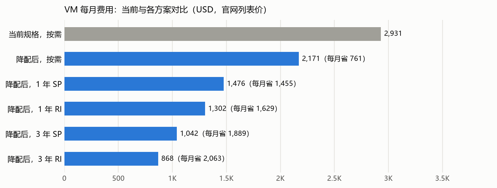
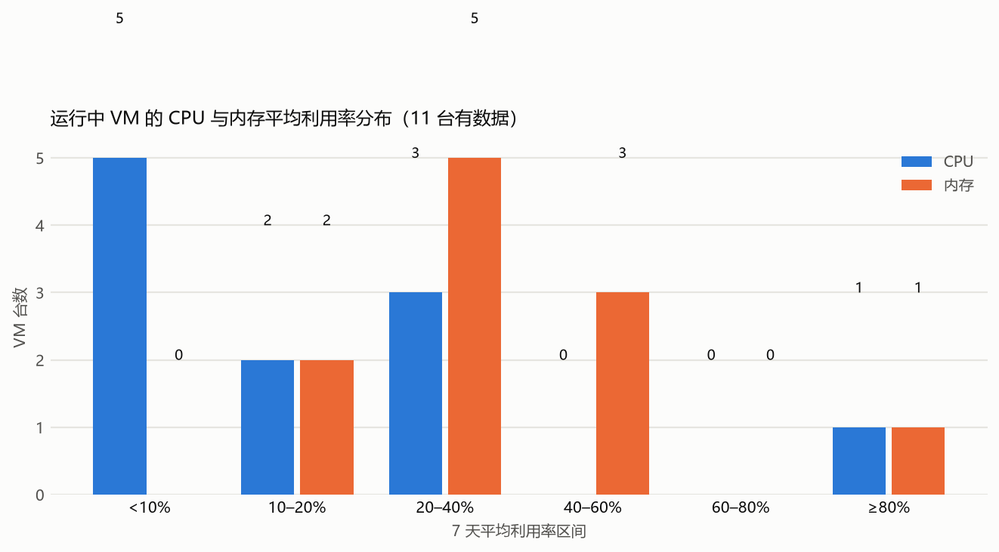
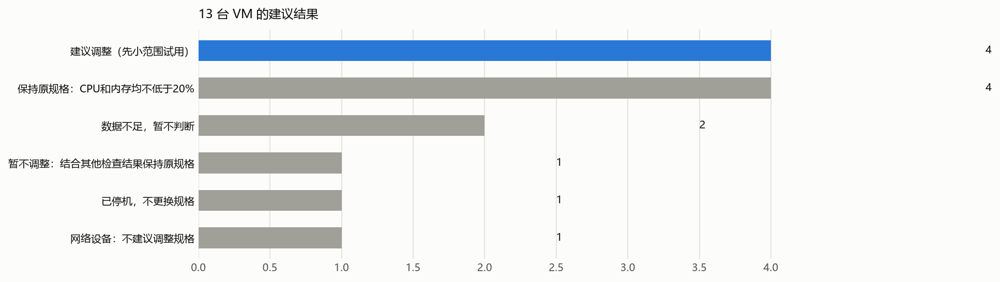
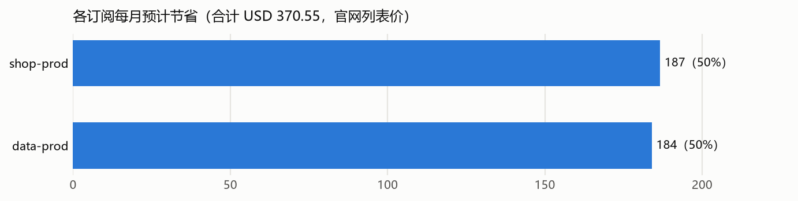

# 示例客户：各订阅 VM 规格建议与预计节省

**所有价格均为 Azure 官网公开列表价（USD），包括按需、RI 和 SP；不是客户合同价或实际账单价。节省也按列表价计算，未考虑客户已有折扣**。

## 1. 范围和结果

- 已核对示例客户纳入巡检的 **5 个订阅**：4 个有 VM/VMSS，1 个没有 VM。另有 1 个订阅无法确认资源：订阅未启用，无法读取（old-lab）。发现的 **13 台机器**中，12 台运行、1 台已释放计算资源。
- 数据窗口为 **2026-10-19T00:00:00Z 至 2026-10-26T00:00:00Z（UTC）**，所有订阅使用同一完整 7 天。
- 建议调整 **4 台机器**，都是独立 VM。
- 仅调整规格、不购买 RI/SP，**预计每月节省 USD 370.55，每年节省 USD 4,446.58**。当前费用及五种方案汇总如下。
- 没有数据或权限不足的机器仍列在逐台明细中，明确写“暂不判断”，不把缺数据当成空闲；数量见 2.2。

**先小范围调整，确认业务正常后再推广**。平均用量低不代表每个忙碌时刻都够用；业务团队需确认重要任务、故障接管和 AKS 资源需求。报告提供分析建议，实际调整需经业务负责人批准。

### 当前费用与调整后五种方案

**以下均按 Azure 官网公开列表价计算，单位 USD，不是实际账单**。比较的是同一批 12 台运行机器的基础计算费用；1 台已释放机器计算费为 0。按需按每台机器在观察窗口内实际运行的比例折算每月小时数（整周运行为 730 小时）；RI/SP 按整月承诺计价，只对承诺比按需便宜的机器计入，其余仍按需。其中 2 台巡检月一半以上费用已由 RI/SP 覆盖（保持现有承诺），这些机器在 RI/SP 方案中仍按按需计算，不重复计算节省。

|方案|每月总价 USD|每月节省 USD|每年总价 USD|每年节省 USD|说明|
|---|---:|---:|---:|---:|---|
|当前规格：按需|2,825.62|0.00|33,907.41|0.00|当前运行机器的按需列表价|
|调整后：按需，不用 RI/SP|2,455.07|370.55|29,460.84|4,446.58|全部运行机器均有对应报价|
|调整后：1 年 RI|1,598.08|1,227.54|19,176.93|14,730.48|1 台运行时间不足，承诺比按需贵，仍按按需计算；2 台已由 RI/SP 覆盖（巡检月一半以上费用），不再重复计算|
|调整后：3 年 RI|1,166.57|1,659.05|13,998.82|19,908.59|2 台已由 RI/SP 覆盖（巡检月一半以上费用），不再重复计算|
|调整后：1 年 SP|1,769.38|1,056.24|21,232.57|12,674.84|1 台运行时间不足，承诺比按需贵，仍按按需计算；2 台已由 RI/SP 覆盖（巡检月一半以上费用），不再重复计算|
|调整后：3 年 SP|1,341.02|1,484.60|16,092.20|17,815.21|1 台运行时间不足，承诺比按需贵，仍按按需计算；2 台已由 RI/SP 覆盖（巡检月一半以上费用），不再重复计算|

**购买 RI/SP 的数量以 Azure 自己的购买建议为准**。Azure 按过去 30 天的实际用量和贵司价格计算，只算稳定在用的部分；上表按最近 7 天的运行情况和官网列表价估算，并包含降配。有自动扩缩的节点池时台数每周会变，7 天可能代表不了整月；官网列表价通常也高于贵司实际价格。所以上表的 RI/SP 节省可能偏高，适合用来比较降配后各种付费方式的差别。

|方案|Azure 建议数量|Azure 建议节省 USD（按过去 30 天，约等于每月）|上表：只算 RI/SP 的每月节省 USD|上表：含降配的每月节省 USD|
|---|---:|---:|---:|---:|
|1 年 RI（虚拟机）|2 台|128.62|856.99|1,227.54|
|3 年 RI（虚拟机）|2 台|210.72|1,288.50|1,659.05|
|1 年 SP|每小时 USD 0.95|188.60|685.69|1,056.24|
|3 年 SP|-|没有建议|1,114.05|1,484.60|

“只算 RI/SP”是降配后再买 RI/SP、比降配后按需多省的部分，可以和 Azure 的建议对照；Azure 的建议按现有规格计算，没有考虑降配；节省计划只算计算节省计划（覆盖所有计算资源，不只虚拟机），不含数据库节省计划。

所有方案的节省均与当前规格按需列表价比较。RI/SP 方案已包含规格调整的效果，各方案分别选择，不相加。

运行中有数据的 11 台 VM 中，7 台 CPU 平均利用率低于 20%，2 台内存平均利用率低于 20%。规则要求只减少利用率低的那一项，另一项容量保留。

## 2. 建议汇总

下面四张表汇总 13 台机器的建议；每台机器的指标、五种价格和备注见 Excel“VM 建议指标价格总表”，可按订阅、资源组和建议结果筛选。表中节省均为调整规格后、按需列表价每月节省的金额（USD）。

### 2.1 按订阅汇总

|订阅|机器数|运行中|建议调整|每月预计节省 USD|
|---|---:|---:|---:|---:|
|shop-prod|7|7|3|186.59|
|data-prod|2|2|1|183.96|
|pay-prod|2|2|0|0.00|
|shop-test|2|1|0|0.00|
|合计|13|12|4|370.55|

### 2.2 按建议结果汇总

|建议结果|台数|运行中|每月预计节省 USD|
|---|---:|---:|---:|
|建议调整（先小范围试用）|4|4|370.55|
|保持原规格：CPU 和内存均不低于 20%|4|4|0.00|
|已停机，不更换规格|1|0|0.00|
|数据不足，暂不判断|1|1|0.00|
|暂不调整：结合其他检查结果保持原规格|1|1|0.00|
|有效数据不足 7 天，暂不判断|1|1|0.00|
|网络设备：不建议调整规格|1|1|0.00|

### 2.3 按规格变化汇总

|当前规格|建议规格|台数|每月预计节省 USD|
|---|---|---:|---:|
|Standard_D4s_v5|Standard_E2s_v5|3|186.59|
|Standard_E8s_v5|Standard_E4s_v5|1|183.96|

### 2.4 节省最多的前 20 项

节点池和 VMSS 的机器需要一起调整，合并为一行。

|订阅|资源组|VM/节点池|台数|当前规格 → 建议规格|CPU 平均%：前→后（预计）|内存平均%：前→后（预计）|每月预计节省 USD|备注|
|---|---|---|---:|---|---|---|---:|---|
|data-prod|data-rg|data-etl-01|1|Standard_E8s_v5 → Standard_E4s_v5|12.35 → 24.69|16.36 → 32.72|183.96|CPU 核数和内存容量都减半；平均用量和 VM 磁盘性能满足要求，列表价更低；夜间批处理时数据盘带宽经常打满（见卓越运营与性能效率巡检报告 P4）；降配前先确认新规格的磁盘吞吐上限足够|
|shop-prod|shop-rg|shop-web-01|1|Standard_D4s_v5 → Standard_E2s_v5|6.47 → 12.94|28.31 → 28.31|62.20|CPU 核数减半，内存容量不变；平均用量和 VM 磁盘性能满足要求，列表价更低；9 月该机器 100% 的费用由 RI/SP 覆盖：降配不会直接减少预付费用，需先交换预留或调整覆盖范围，节省在此之后才能实现|
|shop-prod|shop-rg|shop-web-02|1|Standard_D4s_v5 → Standard_E2s_v5|7.07 → 14.14|30.30 → 30.30|62.20|CPU 核数减半，内存容量不变；平均用量和 VM 磁盘性能满足要求，列表价更低；9 月该机器 100% 的费用由 RI/SP 覆盖：降配不会直接减少预付费用，需先交换预留或调整覆盖范围，节省在此之后才能实现|
|shop-prod|shop-rg|shop-web-03|1|Standard_D4s_v5 → Standard_E2s_v5|6.17 → 12.35|29.30 → 29.30|62.20|CPU 核数减半，内存容量不变；平均用量和 VM 磁盘性能满足要求，列表价更低|

### 2.5 逐台明细

- **排序**：依次按订阅名、资源组名、VM 名称的字母顺序排列，忽略大小写。
- **资源定位**：按订阅、资源组和机器名称查找资源；完整资源 ID 见 Excel。
- **建议更换规格**：建议调整的写新 SKU，其余写“不更换”。不更换按当前规格计算指标和价格。
- **指标箭头**：更换前实测周平均 → 更换后预计周平均；不更换时两边相同。Cached/Uncached 各自显示 IOPS 和吞吐消耗百分比。
- **五列价格**：均按调整后规格报价；写“不更换”的仍按当前规格。每格为“每台月价（每月节省）”，单位 USD。括号里的节省统一与当前规格按需列表价比较，已包含规格调整和所选 RI/SP 优惠。各列是互斥方案，不能相加。
- **月价计算**：按需为每小时列表价 × 每月运行小时（观察窗口内整周运行的按 730 小时，只运行了一部分时间的按实际比例折算）；SP 每小时承诺价 × 730，1 年 RI 订单价 ÷ 12，3 年 RI 订单价 ÷ 36；RI/SP 只对比按需便宜的机器计入汇总。未找到报价显示“无报价”；已停机机器不建议购买 RI/SP。
- **备注**：说明原因、VMSS 或节点池名称；同 VMSS 所有 VM 一起调整，不单独改某一个节点。

|订阅|资源组|VM/机器|Region|当前规格|建议更换规格|建议|CPU 平均%：前→后（预计）|内存平均%：前→后（预计）|Uncached IOPS/吞吐%：前→后（预计）|Cached IOPS/吞吐%：前→后（预计）|调整后规格：按需月价（每月节省）|调整后规格：1 年 RI 月价（每月节省）|调整后规格：3 年 RI 月价（每月节省）|调整后规格：1 年 SP 月价（每月节省）|调整后规格：3 年 SP 月价（每月节省）|备注（含 VMSS）|
|---|---|---|---|---|---|---|---|---|---|---|---:|---:|---:|---:|---:|---|
|data-prod|data-rg|data-etl-01|eastus|Standard_E8s_v5|Standard_E4s_v5|建议调整（先小范围试用）|12.35 → 24.69|16.36 → 32.72|IOPS 13.94 → 27.88；吞吐 20.91 → 41.82|IOPS 6.97 → 13.94；吞吐 4.98 → 9.96|183.96（省 183.96）|110.38（省 257.54）|73.58（省 294.34）|125.12（省 242.80）|88.33（省 279.59）|CPU 核数和内存容量都减半；平均用量和 VM 磁盘性能满足要求，列表价更低；夜间批处理时数据盘带宽经常打满（见卓越运营与性能效率巡检报告 P4）；降配前先确认新规格的磁盘吞吐上限足够|
|data-prod|data-rg|data-worker-01|eastus|Standard_D8s_v5|不更换|保持原规格：CPU 和内存均不低于 20%|30.87 → 30.87|38.27 → 38.27|IOPS 10.95 → 10.95；吞吐 15.93 → 15.93|IOPS 6.97 → 6.97；吞吐 4.98 → 4.98|280.32（省 0.00）|168.19（省 112.13）|112.13（省 168.19）|190.60（省 89.72）|134.54（省 145.78）|CPU 和内存平均利用率均不低于 20%|
|pay-prod|pay-rg|pay-api-01|japaneast|Standard_D4s_v5|不更换|保持原规格：CPU 和内存均不低于 20%|24.39 → 24.39|42.25 → 42.25|IOPS 5.97 → 5.97；吞吐 7.97 → 7.97|IOPS 3.98 → 3.98；吞吐 2.99 → 2.99|180.82（省 0.00）|108.49（省 72.33）|72.33（省 108.49）|122.93（省 57.89）|86.80（省 94.02）|CPU 和内存平均利用率均不低于 20%|
|pay-prod|pay-rg|pay-api-02|japaneast|Standard_D4s_v5|不更换|保持原规格：CPU 和内存均不低于 20%|23.70 → 23.70|43.24 → 43.24|IOPS 5.97 → 5.97；吞吐 7.97 → 7.97|IOPS 3.98 → 3.98；吞吐 2.99 → 2.99|180.82（省 0.00）|108.49（省 72.33）|72.33（省 108.49）|122.93（省 57.89）|86.80（省 94.02）|CPU 和内存平均利用率均不低于 20%|
|shop-prod|shop-net-rg|edge-fw-01|japaneast|Standard_D4s_v5|不更换|网络设备：不建议调整规格|4.18 → 4.18|99.00 → 99.00|IOPS 1.99 → 1.99；吞吐 2.99 → 2.99|IOPS 1.00 → 1.00；吞吐 1.00 → 1.00|180.82（省 0.00）|108.49（省 72.33）|72.33（省 108.49）|122.93（省 57.89）|86.80（省 94.02）|网络设备（镜像发布者 paloaltonetworks）：只能使用厂商支持的规格，授权常按 vCPU 计，规格按厂商建议调整|
|shop-prod|shop-rg|shop-batch-01|japaneast|Standard_D8s_v5|不更换|保持原规格：CPU 和内存均不低于 20%|85.63 → 85.63|59.18 → 59.18|IOPS 21.91 → 21.91；吞吐 29.87 → 29.87|IOPS 10.95 → 10.95；吞吐 8.96 → 8.96|361.64（省 0.00）|216.99（省 144.66）|144.66（省 216.99）|245.94（省 115.71）|173.59（省 188.05）|CPU 和内存平均利用率均不低于 20%|
|shop-prod|shop-rg|shop-search-01|japaneast|Standard_E8s_v5|不更换|暂不调整：结合其他检查结果保持原规格|14.14 → 14.14|15.36 → 15.36|IOPS 8.96 → 8.96；吞吐 11.95 → 11.95|IOPS 5.97 → 5.97；吞吐 3.98 → 3.98|474.65（省 0.00）|284.79（省 189.86）|189.86（省 284.79）|322.73（省 151.91）|227.83（省 246.81）|结合其他检查结果保持原规格（RI/SP 按原规格计算）；暂不更换为 Standard_E4s_v5；每周重建搜索索引时内存接近用满，客户确认暂不调整|
|shop-prod|shop-rg|shop-web-01|japaneast|Standard_D4s_v5|Standard_E2s_v5|建议调整（先小范围试用）|6.47 → 12.94|28.31 → 28.31|IOPS 3.98 → 6.80；吞吐 5.97 → 10.19|IOPS 2.99 → 6.31；吞吐 1.99 → 3.98|118.63（省 62.20）|71.18（省 109.65）|47.45（省 133.37）|80.67（省 100.16）|56.94（省 123.88）|CPU 核数减半，内存容量不变；平均用量和 VM 磁盘性能满足要求，列表价更低；9 月该机器 100% 的费用由 RI/SP 覆盖：降配不会直接减少预付费用，需先交换预留或调整覆盖范围，节省在此之后才能实现|
|shop-prod|shop-rg|shop-web-02|japaneast|Standard_D4s_v5|Standard_E2s_v5|建议调整（先小范围试用）|7.07 → 14.14|30.30 → 30.30|IOPS 3.98 → 6.80；吞吐 5.97 → 10.19|IOPS 2.99 → 6.31；吞吐 1.99 → 3.98|118.63（省 62.20）|71.18（省 109.65）|47.45（省 133.37）|80.67（省 100.16）|56.94（省 123.88）|CPU 核数减半，内存容量不变；平均用量和 VM 磁盘性能满足要求，列表价更低；9 月该机器 100% 的费用由 RI/SP 覆盖：降配不会直接减少预付费用，需先交换预留或调整覆盖范围，节省在此之后才能实现|
|shop-prod|shop-rg|shop-web-03|japaneast|Standard_D4s_v5|Standard_E2s_v5|建议调整（先小范围试用）|6.17 → 12.35|29.30 → 29.30|IOPS 3.98 → 6.80；吞吐 4.98 → 8.49|IOPS 2.99 → 6.31；吞吐 1.99 → 3.98|118.63（省 62.20）|71.18（省 109.65）|47.45（省 133.37）|80.67（省 100.16）|56.94（省 123.88）|CPU 核数减半，内存容量不变；平均用量和 VM 磁盘性能满足要求，列表价更低|
|shop-prod|shop-rg|shop-web-04|japaneast|Standard_D4s_v5|不更换|数据不足，暂不判断|5.78 → 5.78|27.31 → 27.31|IOPS 3.98 → 3.98；吞吐 4.98 → 4.98|IOPS 2.99 → 2.99；吞吐 1.99 → 1.99|75.34（省 0.00）|108.49（增加 33.15）|72.33（省 3.01）|122.93（增加 47.59）|86.80（增加 11.45）|CPU/内存采样不足，或规格/价格信息不完整|
|shop-test|shop-test-rg|shop-web-test-01|japaneast|Standard_D4s_v5|不更换|有效数据不足 7 天，暂不判断|无数据 → 无数据|无数据 → 无数据|IOPS 无数据 → 无数据；吞吐 无数据 → 无数据|IOPS 无数据 → 无数据；吞吐 无数据 → 无数据|180.82（省 0.00）|108.49（省 72.33）|72.33（省 108.49）|122.93（省 57.89）|86.80（省 94.02）|观察的 7 天内没有 CPU/内存读数，需确认监控指标是否正常|
|shop-test|shop-test-rg|shop-web-test-02|japaneast|Standard_D4s_v5|不更换|已停机，不更换规格|无数据 → 无数据|无数据 → 无数据|IOPS 无数据 → 无数据；吞吐 无数据 → 无数据|IOPS 无数据 → 无数据；吞吐 无数据 → 无数据|0.00（省 0.00）|不建议购买|不建议购买|不建议购买|不建议购买|计算费已停止；保留的磁盘和 IP 仍可能收费|

其中 2 台建议调整的机器在 9 月有一半以上费用由 RI/SP 覆盖，涉及预计节省 USD 124.39/月。这些机器降配后，预留或节省计划的额度会转去覆盖其他机器或闲置，不会直接减少费用；需先交换预留或调整覆盖范围，节省在此之后才能实现。逐台情况见 Excel“VM 建议指标价格总表”的备注列。

## 3. 使用的规则

- CPU 和内存独立判断：准备减少的那项平均利用率<20%；另一项容量保留，每项最多减半，同代保留所需功能。
- 目标 VM 的 Cached/Uncached IOPS 和吞吐平均消耗率各 ≤ 50%，不相加，不查单盘 IO，也不使用 Max/P99 作门槛。
- Batch API 日平均按 Count 加权；要有 7 天有效数据和足够采样。缺指标、报价或规格信息时不推荐调整。
- 按机器所在订阅、区域和可用区检查目标规格是否可部署。
- 目标价格要更低，磁盘/网卡数量及架构、缓存、临时盘、安全配置要满足；同池运行节点有共同目标才一起调整。
- 购买 RI/SP 前需确认长期用量和期限；SP 不能随时取消。

[Azure VM 官网定价入口](https://azure.microsoft.com/en-us/pricing/details/virtual-machines/linux/)。只算 VM 基础计算费，不含磁盘、网络或付费软件。

## 4. 订阅覆盖和其他范围

已确认没有 VM/VMSS 实例的订阅：shared-network。它们可能有其他服务费用，本报告不计算那些费用。

另有 1 个订阅无法确认资源：订阅未启用，无法读取（old-lab）。具体订阅见 Excel“订阅范围”页。

每个订阅的机器数量、建议调整数量和节省见 2.1 和 Excel“订阅范围”页。缺数据/权限及目标不满足的原因汇总见 2.2，逐台原因见逐台明细的备注。

报告仅覆盖 VM 规格与费用分析。闲置资源清理、其他 Azure 服务和更全面的架构评估不在此范围。

## 官方依据

- [Batch API](https://learn.microsoft.com/en-us/rest/api/monitor/metrics-batch/batch?view=rest-monitor-2023-10-01)
- [Average 与 Count 聚合](https://learn.microsoft.com/en-us/azure/azure-monitor/metrics/metrics-aggregation-explained)
- [VM 级磁盘消耗指标](https://learn.microsoft.com/en-us/azure/virtual-machines/disks-metrics)
- [SKU 能力与限制](https://learn.microsoft.com/en-us/rest/api/compute/resource-skus/list)
