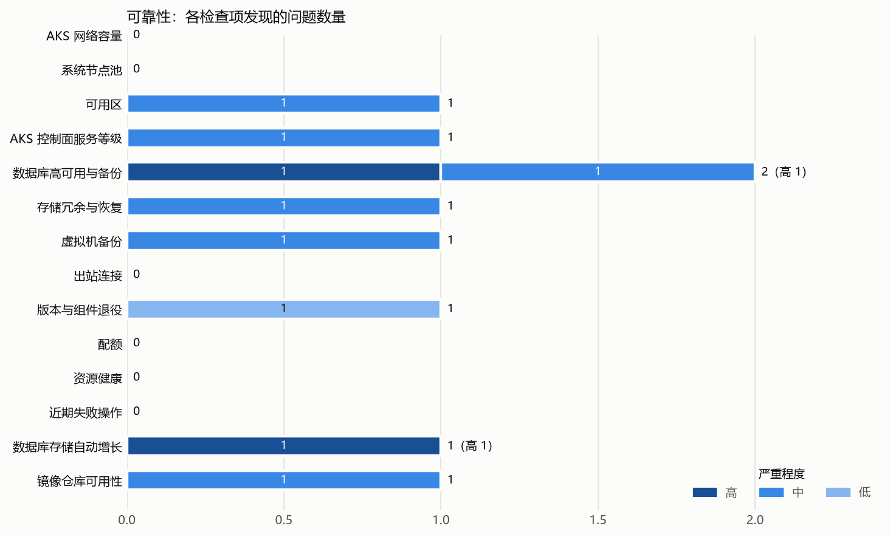
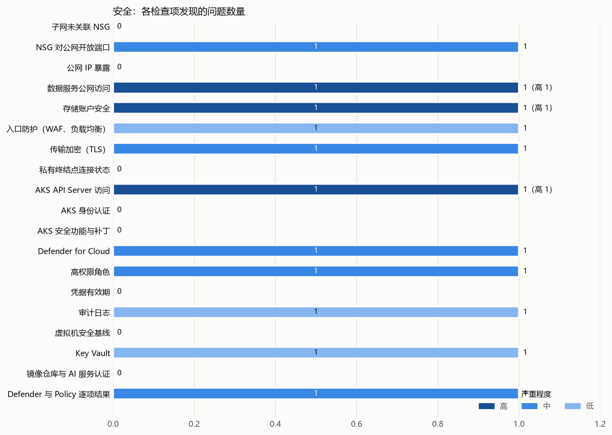

# 示例客户 Azure 可靠性与安全巡检报告

**检查时间：2026 年 10 月 26 日。范围：示例客户 5 个 Azure 订阅（另有 1 个未启用订阅（old-lab）无法读取，未纳入检查）。方式：只读读取配置、指标和日志，未修改任何资源，也未做端口扫描**。

共发现 **20** 项问题：可靠性 9 项（高 2、中 6、低 1），安全 11 项（高 3、中 5、低 3）。其中 2 项附有需要客户确认的事项（见 Excel“需要客户确认”列）。同类问题已按订阅或资源合并，完整清单见 Excel。

严重程度：**高**＝可能直接导致故障、数据丢失或被入侵；**中**＝单点故障或缺少必要防护；**低**＝建议改进。生产或测试环境按名称或标签推断，需客户确认。

与 2026-08 相比：新增检查项发现 1 项，仍未处理 19 项，已解决 1 项。“新增检查项发现”来自本月起新增或首次成功执行的检查（Defender 与 Policy 逐项结果（Defender/Policy）），不代表情况变差。另有 1 项严重程度有变化，见 Excel“与上月相比”列。

## 1. 需要优先处理的问题

|#|问题|影响|建议|
|---|---|---|---|
|1|**支付数据库对全网开放**。pay-mysql-prod 的防火墙规则 AllowAll 放行所有地址，且没有强制加密连接。|任何人都能连接支付数据库端口，只靠密码防护。|**根本原因**：该库在门户手工创建，并在门户上点了“允许全部”；其他生产库都由 Terraform 模块创建、只走私有终结点。**根治**：按模块改为私有终结点访问，删除公网规则。**短期**：立即删除 AllowAll 规则，只保留办公网出口 IP。|
|2|**存储容器可匿名访问**。shopassets 的 exports 容器允许匿名列出和下载。|如存放内部文件，可能已对外泄露。|确认容器内容；不需要公开的关闭匿名访问|
|3|**支付数据库没有高可用和异地备份**。pay-mysql-prod 单可用区部署，备份只在本区域。|可用区故障时支付服务中断。|开启跨可用区高可用和异地冗余备份|
|4|**AKS 管理接口对公网开放**。shop-aks 的 API Server 不限制来源 IP，本地账号未禁用。|拿到凭据的人可从任何地方管理集群。|设置授权 IP 范围；集成 Entra ID 并禁用本地账号|
|5|**PostgreSQL 关闭了存储自动增长**。data-pg-prod 存储已用约 71%。|写满后数据库变为只读。|开启存储自动增长并配置存储告警|

## 2. 可靠性

表中“高、中、低”是问题条数，即 Excel 问题清单的行数：同类问题按订阅或资源合并为一条，重要问题按资源单独列出。“涉及资源数”是这些问题涉及的资源数量，同一资源在一个检查项下只算一次。

|检查项|高|中|低|涉及资源数|主要发现|
|---|---:|---:|---:|---|---|
|AKS 网络容量|0|0|0|—|未发现问题|
|系统节点池|0|0|0|—|未发现问题|
|可用区|0|1|0|4 台虚拟机|4 台前端虚拟机 shop-web-01～04 都部署在同一可用区，没有分布到多个可用区|
|AKS 控制面服务等级|0|1|0|1 个集群|AKS 集群 shop-aks（生产）使用 Free 层，控制面没有 SLA|
|数据库高可用与备份|1|1|0|2 个 MySQL|支付库 pay-mysql-prod 没有高可用和异地备份|
|存储冗余与恢复|0|1|0|1 个存储账户|存储账户 datalakeraw（约 26 TiB）为本地冗余（LRS），没有开启 Blob 软删除|
|虚拟机备份|0|1|0|2 台虚拟机|2 台保存数据的虚拟机没有备份|
|出站连接|0|0|0|—|未发现问题|
|版本与组件退役|0|0|1|1 个集群|AKS 集群 shop-aks 的 Kubernetes 版本 1.31 将在 3 个月内结束标准支持|
|配额|0|0|0|—|未发现问题|
|资源健康|0|0|0|—|未发现问题|
|近期失败操作|0|0|0|—|未发现问题|
|数据库存储自动增长|1|0|0|1 个 PostgreSQL|PostgreSQL 关闭了存储自动增长，磁盘写满后数据库会变为只读：data-pg-prod（存储已用约 71%）|
|镜像仓库可用性|0|1|0|1 个镜像仓库|镜像仓库不是 Premium 层，不支持异地复制和区域冗余，限流也更低：contosoacr|

## 3. 安全

表中“高、中、低”是问题条数，即 Excel 问题清单的行数：同类问题按订阅或资源合并为一条，重要问题按资源单独列出。“涉及资源数”是这些问题涉及的资源数量，同一资源在一个检查项下只算一次。

|检查项|高|中|低|涉及资源数|主要发现|
|---|---:|---:|---:|---|---|
|子网未关联 NSG|0|0|0|—|未发现问题|
|NSG 对公网开放端口|0|1|0|1 个 NSG|NSG shop-web-nsg 允许 Internet 任意来源访问 SSH（22）|
|公网 IP 暴露|0|0|0|—|未发现问题|
|数据服务公网访问|1|0|0|1 个 MySQL|pay-mysql-prod 对全网开放|
|存储账户安全|1|0|0|1 个存储账户|shopassets 的 exports 容器可匿名访问|
|入口防护（WAF、负载均衡）|0|0|1|1 个应用网关|应用网关 shop-appgw 的 WAF 策略为检测模式，只记录不拦截|
|传输加密（TLS）|0|1|0|1 个 Redis|Redis shop-redis-prod 开启了非 TLS 端口（6379）|
|私有终结点连接状态|0|0|0|—|未发现问题|
|AKS API Server 访问|1|0|0|1 个集群|shop-aks API Server 不限制来源 IP|
|AKS 身份认证|0|0|0|—|未发现问题|
|AKS 安全功能与补丁|0|0|0|—|未发现问题|
|Defender for Cloud|0|1|0|1 个订阅|data-prod 订阅的 Defender 服务器和数据库计划为免费层，有 6 条高严重性建议未处理|
|高权限角色|0|1|0|2 个来宾账号|2 个来宾账号在 shop-prod 订阅拥有 Owner 权限|
|凭据有效期|0|0|0|—|未发现问题|
|审计日志|0|0|1|5 个订阅|5 个订阅的活动日志都没有导出，只能保留 90 天|
|虚拟机安全基线|0|0|0|—|未发现问题|
|Key Vault|0|0|1|1 个 Key Vault|Key Vault pay-kv 没有开启清除保护|
|镜像仓库与 AI 服务认证|0|0|0|—|未发现问题|
|Defender 与 Policy 逐项结果|0|1|0|6 台虚拟机|Defender for Cloud 高严重性建议“Machines should have vulnerability findings ……|

## 4. Landing Zone 对照

按微软 Azure Landing Zone 检查清单中可自动核对的 16 条：6 条有不符合项，5 条全部符合，5 条没有相关资源。这些是架构设计参考，不计入上面的问题数；与上面问题重复的，以问题清单为准。完整结果见 Excel“Landing Zone 对照”。

|领域|条目|清单重要性|不符合|符合|示例|
|---|---|---|---:|---:|---|
|身份与访问|用 Entra 组分配权限，而不是直接分配给个人|中|2|3|shop-vnet、data-vnet|
|身份与访问|身份服务放在独立虚拟网络并与中心网络对等|高|2|3|shop-vnet、data-vnet|
|资源组织|订阅不直接放在根管理组下|中|2|3|shop-vnet、data-vnet|
|网络拓扑与连接|单区域分支网络超过 400 个时增加中心网络|中|2|3|shop-vnet、data-vnet|
|网络拓扑与连接|使用 RFC 1918 私有地址段|中|2|3|shop-vnet、data-vnet|
|网络拓扑与连接|按带宽需求选择专线/VPN 网关规格|中|2|3|shop-vnet、data-vnet|

## 5. 建议处理顺序

- **本周内**：删除 pay-mysql-prod 的全网放行规则；确认 shopassets/exports 内容并关闭匿名访问。
- **一个月内**：为 pay-mysql-prod 开启高可用和异地备份；限制 shop-aks API Server 来源 IP；为保存数据的虚拟机配置备份。
- **一个季度内**：把手工创建的数据库按 Terraform 模块对齐；AKS 升级到 Standard 层并规划版本升级。

每项问题的资源明细、建议、验收标准和需要客户确认的内容见 Excel“问题清单”，可直接用于分配负责人和跟踪处理状态。

## 6. 检查范围与限制

- 另有 1 个未启用订阅（old-lab）无法读取，未纳入检查。
- 端口是否对公网开放是根据 NSG、公网 IP 和负载均衡规则离线判断，未做端口扫描或连接测试。
- 集群内部配置（Pod 副本数、PodDisruptionBudget、健康检查、资源请求）需要 AKS 只读访问，本次未检查。
- 只读取了凭据的到期时间等元数据，未读取任何密钥、密码或连接字符串。
- 生产或测试环境按订阅、资源名称和标签推断，请客户确认。
- 配置为 2026 年 10 月 26 日读取的状态；读取后客户如有调整，以实际为准。

## Microsoft 官方参考

- [可靠性检查表](https://learn.microsoft.com/en-us/azure/well-architected/reliability/checklist)
- [安全性检查表](https://learn.microsoft.com/en-us/azure/well-architected/security/checklist)
- [AKS 的 Well-Architected 服务指南](https://learn.microsoft.com/en-us/azure/well-architected/service-guides/azure-kubernetes-service)
- [AKS API Server 访问控制](https://learn.microsoft.com/en-us/azure/aks/api-server-authorized-ip-ranges)
