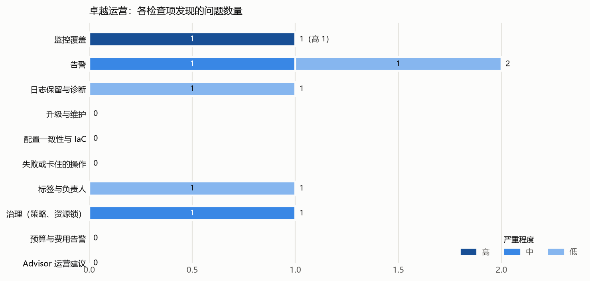
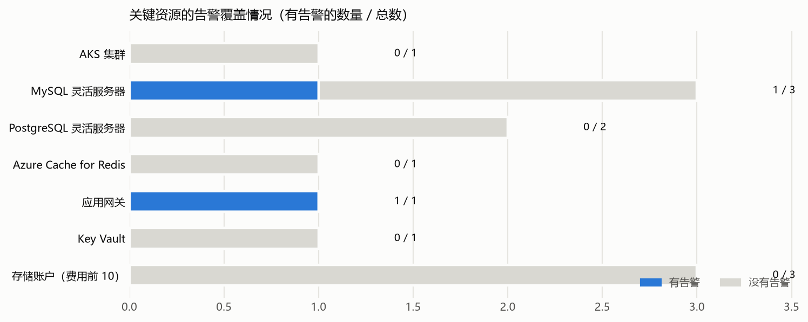
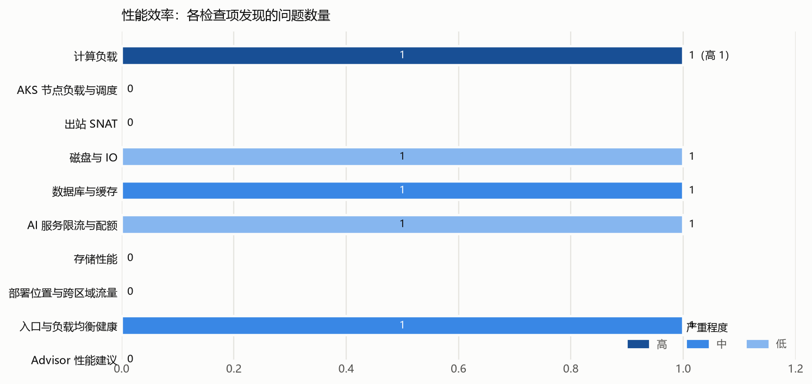

# 示例客户 Azure 卓越运营与性能效率巡检报告

**检查时间：2026 年 10 月 26 日。范围：示例客户 5 个 Azure 订阅（另有 1 个未启用订阅（old-lab）无法读取，未纳入检查）。性能数据窗口：2026 年 9 月 26 日至 10 月 26 日。方式：只读读取配置、指标、告警和日志，未修改任何资源**。

共发现 **11** 项问题：卓越运营 6 项（高 1、中 2、低 3），性能效率 5 项（高 1、中 2、低 2）。其中 0 项附有需要客户确认的事项（见 Excel“需要客户确认”列）。同类问题已按订阅或资源合并，完整清单见 Excel。

严重程度：**高**＝故障可能无人发现，或用户已经受到影响；**中**＝监控覆盖缺口或接近容量上限；**低**＝建议改进。性能判断看两点：平均负载是否持续偏高，以及每日最高值打满的天数。生产或测试环境按名称或标签推断，需客户确认。

与 2026-08 相比：新增问题 1 项，仍未处理 10 项，已解决 1 项。

## 1. 需要优先处理的问题

|#|问题|影响|建议|
|---|---|---|---|
|1|**shop-batch-01 CPU 长期打满**。30 天平均 86%，21 天日最高超过 95%。|批处理任务排队变慢。|确认是否为预期负载；是的话升到 16 vCPU 或拆分任务|
|2|**生产集群没有监控**。shop-aks 没有 Container Insights 和任何告警。|节点或 Pod 故障时没人第一时间知道。|启用 Container Insights 并配置基础告警|
|3|**Redis 内存快速增长**。shop-redis-prod 内存从 12% 涨到 41%。|约 6 周后达到 80%，可能驱逐数据。|确认增长原因，必要时提前扩容|

## 2. 卓越运营

表中“高、中、低”是问题条数，即 Excel 问题清单的行数：同类问题按订阅或资源合并为一条，重要问题按资源单独列出。“涉及资源数”是这些问题涉及的资源数量，同一资源在一个检查项下只算一次。

|检查项|高|中|低|涉及资源数|主要发现|
|---|---:|---:|---:|---|---|
|监控覆盖|1|0|0|1 个集群|生产集群 shop-aks 在 Azure 侧没有任何监控和告警：未启用 Container Insights 和托管 Prometheus……|
|告警|0|1|1|2 个 MySQL、2 个 PostgreSQL、1 个 Redis|4 个生产数据库和缓存没有任何 Azure 告警规则：pay-mysql-prod、pay-pg-prod、data-pg-prod、sho……|
|日志保留与诊断|0|0|1|2 个日志工作区|2 个日志工作区都只保留 30 天|
|升级与维护|0|0|0|—|未发现问题|
|配置一致性与 IaC|0|0|0|—|未发现问题|
|失败或卡住的操作|0|0|0|—|未发现问题|
|标签与负责人|0|0|1|1 个资源|78% 的资源没有负责人标签|
|治理（策略、资源锁）|0|1|0|1 个资源|没有任何资源锁，关键生产资源（数据库、存储账户）可能被误删|
|预算与费用告警|0|0|0|—|未发现问题|
|Advisor 运营建议|0|0|0|—|未发现问题|

## 3. 性能效率

表中“高、中、低”是问题条数，即 Excel 问题清单的行数：同类问题按订阅或资源合并为一条，重要问题按资源单独列出。“涉及资源数”是这些问题涉及的资源数量，同一资源在一个检查项下只算一次。

|检查项|高|中|低|涉及资源数|主要发现|
|---|---:|---:|---:|---|---|
|计算负载|1|0|0|1 台虚拟机|虚拟机 shop-batch-01（Standard_D8s_v5）过去 30 天 CPU 平均 86%，有 21 天日最高 CPU 超过 ……|
|AKS 节点负载与调度|0|0|0|—|未发现问题|
|出站 SNAT|0|0|0|—|未发现问题|
|磁盘与 IO|0|0|1|1 台虚拟机|虚拟机 data-etl-01 的数据盘带宽在 30 天里有 9 天日最高达到 100%（平均 21%）|
|数据库与缓存|0|1|0|1 个 Redis|Redis shop-redis-prod 内存使用从首周平均 12% 涨到末周 41%，每天约增加 1 个百分点，约 6 周后达到 80%|
|AI 服务限流与配额|0|0|1|1 个 AI 账户|AI 账户 data-openai 30 天有 0.8% 的请求被限流（429），集中在工作日上午|
|存储性能|0|0|0|—|未发现问题|
|部署位置与跨区域流量|0|0|0|—|未发现问题|
|入口与负载均衡健康|0|1|0|1 个应用网关|应用网关 shop-appgw 30 天响应中 5xx 占 1.4%，有 6 天超过 2%|
|Advisor 性能建议|0|0|0|—|未发现问题|

## 4. 建议处理顺序

- **本周内**：
  - 确认 shop-redis-prod 内存增长原因
  - 确认 shop-batch-01 的负载是否正常
- **一个月内**：
  - 为 shop-aks 和生产数据库补齐监控告警
  - 为关键数据资源加删除锁
- **一个季度内**：
  - 统一在 IaC 模块中加负责人和成本中心标签
  - 按需要延长日志保留期

每项问题的资源明细、建议、验收标准和需要客户确认的内容见 Excel“问题清单”，可直接用于分配负责人和跟踪处理状态。

## 5. 检查范围与限制

- 另有 1 个未启用订阅（old-lab）无法读取，未纳入检查。
- 没有集群只读访问时，集群内自建的监控只能从节点池和磁盘名称推断。
- 生产或测试环境按订阅、资源名称和标签推断，请客户确认。
- 配置为 2026 年 10 月 26 日读取的状态；读取后客户如有调整，以实际为准。

## Microsoft 官方参考

- [卓越运营检查表](https://learn.microsoft.com/en-us/azure/well-architected/operational-excellence/checklist)
- [性能效率检查表](https://learn.microsoft.com/en-us/azure/well-architected/performance-efficiency/checklist)
- [AKS 的 Well-Architected 服务指南](https://learn.microsoft.com/en-us/azure/well-architected/service-guides/azure-kubernetes-service)
- [Azure Monitor 建议告警规则（AKS）](https://learn.microsoft.com/en-us/azure/azure-monitor/containers/kubernetes-metric-alerts)
