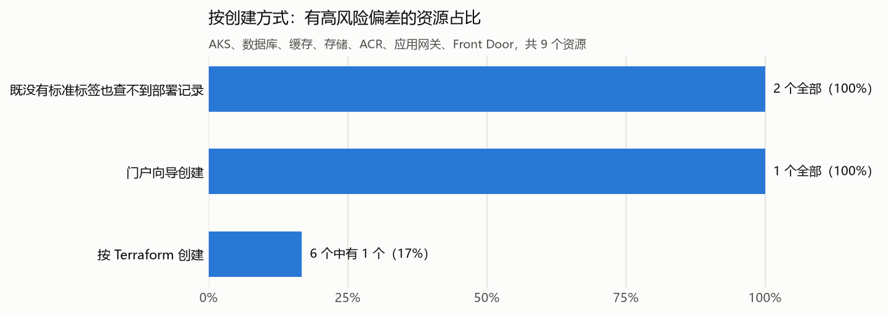

# 示例客户 Azure 同类资源配置对比报告

**检查时间：2026 年 10 月 26 日。范围：示例客户 5 个 Azure 订阅（另有 1 个未启用订阅无法读取）。方式：只读，未修改任何资源**。

本报告把同一类资源放在一起比较（共 4 类），找出客户自己已经在用的好做法，列出和它不一样的资源，并说明原因和怎么对齐。共列出 8 项偏差，逐项明细见 Excel“偏差明细”。

## 1. 结论

- **偏差与创建方式有关**。有高风险偏差的资源：既没有标准标签也查不到部署记录的资源 2 个全部（100%），门户向导创建的资源 1 个全部（100%），按 Terraform 创建的资源 6 个中有 1 个（17%）。
- **按 Terraform 创建的资源也有偏差**。6 个中 2 个与标准做法不同，说明部分模板默认值需要修正，见“需要修正的模板默认值”。

## 2. 什么是“标准做法”和“偏差”

**标准做法**是客户自己的资源里已经在用、而且符合微软推荐的做法，多数取自按 Terraform 创建的资源；某类资源没有内部范例时，直接用微软推荐做法。**偏差**是参数和标准做法不一样的资源。

**高风险偏差**是直接对应安全风险或已经引发故障的偏差，包括：AKS 用节点子网分配 Pod IP，或 API Server 对公网开放；数据库有公网防火墙规则或没有私有终结点；Redis 没有私有终结点或用明文协议；业务存储账户对全网开放或允许 TLS 1.0；容器镜像仓库开着管理员账号；应用网关或 Front Door 没有有效的 WAF。

## 3. 最重要的 4 项偏差

按影响排序：已经引发故障的、对全网开放的、保存重要数据的排在前面。“原地修改”指在现有资源上改配置，不需要重建。

|#|资源|与标准做法的差异|原因|怎么对齐|短期措施|
|---|---|---|---|---|---|
|1|**pay-mysql-prod**（支付，MySQL 灵活服务器）|网络访问：公网开关=Enabled，私有终结点 0 个，公网防火墙规则 1 条，含全网放行规则 AllowAll_2026-3-14 → 仅私有终结点，无公网防火墙规则（最好再关闭公网开关）；强制 TLS（require_secure_transport）：OFF → ON；高可用：Disabled → ZoneRedundant（跨可用区）；备份保留天数：7 天 → 14 天（按标准方式创建的生产库做法）|创建方式：Azure 门户“创建 MySQL 灵活服务器”向导（部署 MySqlFlexibleServer_2026-3-14T02.11.05，2026-03-14）；1 条防火墙规则名称为门户按钮自动生成格式（ClientIPAddress_日期 / AllowAll_日期），说明是在门户里点“添加当前客户端 IP / 允许全部”加上的|**原地修改（需维护窗口或应用配合）**：为服务器创建私有终结点（或复用已有终结点），把应用连接串切到私有地址后删除全部公网防火墙规则并关闭公网访问；把 require_secure_transport 改为 ON（动态参数，无需重启）；把高可用改为跨可用区（先关闭同可用区 HA 再按跨可用区重新开启，确认区域支持）；把备份保留期调到 14 天|立即删除全网放行规则 AllowAll_2026-3-14|
|2|**shopassets**（电商，存储账户）|网络访问：公网=Enabled，默认动作=Allow，IP/VNet 规则 0/0，私有终结点 0 个 → 关闭公网或默认拒绝 + 私有终结点；Blob 软删除：未开启 → 开启；允许匿名 Blob 访问：True → 禁止（allowBlobPublicAccess = false）|创建方式：未知：没有标准创建标签，部署历史中也没有创建记录；创建时间：2024-11-05|**原地修改（需维护窗口或应用配合）**：先加私有终结点、切换内部访问后关闭公网；开启 Blob 与容器软删除（建议 7~14 天）；关闭账户级匿名访问开关（当前没有匿名容器的账户可直接关闭）|至少把默认动作改为 Deny 并只放行确需的出口 IP|
|3|**datalakeraw**（数据平台，存储账户）|网络访问：公网=Enabled，默认动作=Allow，IP/VNet 规则 0/0，私有终结点 0 个 → 关闭公网或默认拒绝 + 私有终结点；最低 TLS 版本：TLS1_0 → TLS1_2（3/4 个账户）；Blob 软删除：未开启 → 开启|创建方式：Terraform（带 managed_by = terraform 标签）；创建时间：2024-08-20；最低 TLS 为 1.0，通常是旧版接口或迁移工具建账户时的默认值（门户新建默认是 TLS1.2）；按 Terraform 创建但仍对全网开放：存储账户模板没有统一设置网络规则|**原地修改（需维护窗口或应用配合）**：先加私有终结点、切换内部访问后关闭公网；把最低 TLS 版本改为 1.2（Azure 存储已停止支持 TLS 1.0/1.1）；开启 Blob 与容器软删除（建议 7~14 天）|至少把默认动作改为 Deny 并只放行确需的出口 IP|
|4|**shop-mysql-test**（电商，MySQL 灵活服务器）|网络访问：公网开关=Enabled，私有终结点 0 个，公网防火墙规则 1 条 → 仅私有终结点，无公网防火墙规则（最好再关闭公网开关）|创建方式：未知：没有标准创建标签，部署历史中也没有创建记录；1 条防火墙规则名称为门户按钮自动生成格式（ClientIPAddress_日期 / AllowAll_日期），说明是在门户里点“添加当前客户端 IP / 允许全部”加上的|**原地修改（需维护窗口或应用配合）**：为服务器创建私有终结点（或复用已有终结点），把应用连接串切到私有地址后删除全部公网防火墙规则并关闭公网访问|—|

## 4. 各类资源的标准做法与例外

“完全符合标准的数量”指所有比较项都符合标准做法的资源数量。虚拟机按订阅分组比较，数据库日志与告警按业务线分组比较。

|资源类型|标准做法|完全符合标准的数量|主要例外和原因|对齐建议|
|---|---|---|---|---|
|MySQL 灵活服务器|网络访问：仅私有终结点，无公网防火墙规则（最好再关闭公网开关）；强制 TLS（require_secure_transport）：ON；高可用：ZoneRedundant（跨可用区）；备份保留天数：14 天（按标准方式创建的生产库做法）|3 个都不完全符合|shop-mysql-prod、pay-mysql-prod、shop-mysql-test|原地修改（需维护窗口或应用配合）|
|PostgreSQL 灵活服务器|网络访问：私有访问（私有终结点或 VNet 集成），无公网防火墙规则；强制 TLS（require_secure_transport）：on；高可用：ZoneRedundant（跨可用区）|2 个全部符合|没有偏差|—|
|存储账户|网络访问：关闭公网或默认拒绝 + 私有终结点；最低 TLS 版本：TLS1_2（3/4 个账户）；Blob 软删除：开启；允许匿名 Blob 访问：禁止（allowBlobPublicAccess = false）|4 个中 2 个|shopassets、datalakeraw|原地修改（需维护窗口或应用配合）|
|数据库与缓存的日志与告警|诊断日志导出：慢查询/审计等日志导出到 Log Analytics|4 个实例中 0 个导出了日志|支付：2 个生产数据库/缓存、数据平台：1 个生产数据库/缓存、电商：1 个生产数据库/缓存|原地修改|

## 5. 需要修正的模板默认值

下面这些偏差出在按 Terraform 创建的资源上，说明模板参数本身需要修正。只改现有资源不改模板，以后新建的资源还会带着同样的问题。

|模板/业务线|当前默认值|应改为|影响的资源|
|---|---|---|---|
|MySQL 灵活服务器 模板|高可用：SameZone|ZoneRedundant（跨可用区）|shop-mysql-prod|
|存储账户 模板|网络访问：公网=Enabled，默认动作=Allow，IP/VNet 规则 0/0，私有终结点 0 个|关闭公网或默认拒绝 + 私有终结点|datalakeraw|
|存储账户 模板|最低 TLS 版本：TLS1_0|TLS1_2（3/4 个账户）|datalakeraw|
|存储账户 模板|Blob 软删除：未开启|开启|datalakeraw|

## 6. 供应商创建的资源

贵司没有提供供应商维护资源的命名或资源组规则，本报告把全部资源当作贵司自己的资源。如果有供应商维护的资源，请提供规则，下次巡检会单独列出；这类资源应与供应商确认后再修改。

## 7. 没有内部范例的共同缺口

下列配置所有同类资源都一样缺，没有可以参照的内部资源，按微软推荐统一补齐，并写进模板默认值。

|资源类型|缺口|现状|微软推荐做法|
|---|---|---|---|
|MySQL 灵活服务器|异地冗余备份|3/3 台没开异地冗余备份；该设置只能在创建时选择，补齐需要“时间点还原到开启异地备份的新服务器”后切换，建议放到下次重建或大版本升级时一并处理。|生产库开启异地冗余备份（只能在创建时选择，结合下次重建或大版本升级处理）|
|MySQL 灵活服务器|Azure 告警规则|见“数据库与缓存的日志与告警”。|配置 CPU、内存、存储、连接数、可用性告警|
|PostgreSQL 灵活服务器|Azure 告警规则|见“数据库与缓存的日志与告警”。|配置 CPU、内存、存储、连接数、可用性告警|
|存储账户|共享密钥访问|3/4 个账户允许共享密钥访问，没有统一改为只用 Entra ID；建议先从 IaC 状态和备份账户开始关闭共享密钥。|关闭共享密钥，改用 Entra ID 授权（先从 IaC 状态账户和备份账户开始）|
|数据库与缓存的日志与告警|Azure 告警规则|告警覆盖见卓越运营检查 O2（告警）。|配置 CPU、内存、存储、连接数、可用性告警|

## 8. 方法与局限

**怎么判断原因**：

- 标准创建标签：资源带 `managed_by=terraform` 标签，视为按 Terraform 创建。
- 创建时间：本次未取得。
- 门户部署记录：资源组部署历史中出现门户向导的部署名（如 microsoft.aks-*、CreateRedisEnterprise-*、PostgreSqlFlexibleServer_*、CreateVm-*），视为门户向导创建。
- 防火墙规则名称：ClientIPAddress_日期、AllowAll_日期 是门户“添加当前客户端 IP”“允许全部”按钮自动生成的格式，说明规则是在门户上加的。
- 环境（生产、测试）按标签、资源名称和订阅名推断，请客户确认。

**局限**：

- 资源创建时间未取得（没有 raw/peer 的采集数据），原因分析只用了标签和部署历史，创建时间显示为“未取得”。
- 没有读取具体创建人账号（活动日志只保留 90 天且含个人信息），只按部署历史判断创建方式。
- 部署历史每个资源组最多保留 800 条，IaC 工具（如 Terraform）不留部署记录，因此“查不到部署记录”不能证明不是门户创建。
- AKS 节点资源组（MC_*）内的资源和 AKS 自动创建的存储账户由平台管理，没有参与比较。
- 没有比较：NAT 网关和负载均衡（可靠性报告单独检查）、Event Hubs、Private Link Service、VPN 网关；数据库参数只比较了强制 TLS。
- 虚拟机系统内的配置（sshd、防火墙）无法从 Azure 读取；由磁盘创建的虚拟机无法判断是否允许密码登录。
- 高风险偏差比例只统计了第 1 节所列 9 个资源（其中 4 个有高风险偏差），虚拟机、网络、Key Vault、AI 账户未计入。
- “可原地修改”“需重建”等判断依据目前的 Azure 功能，实施前请按微软当前文档再确认一次，并先在测试环境演练。
